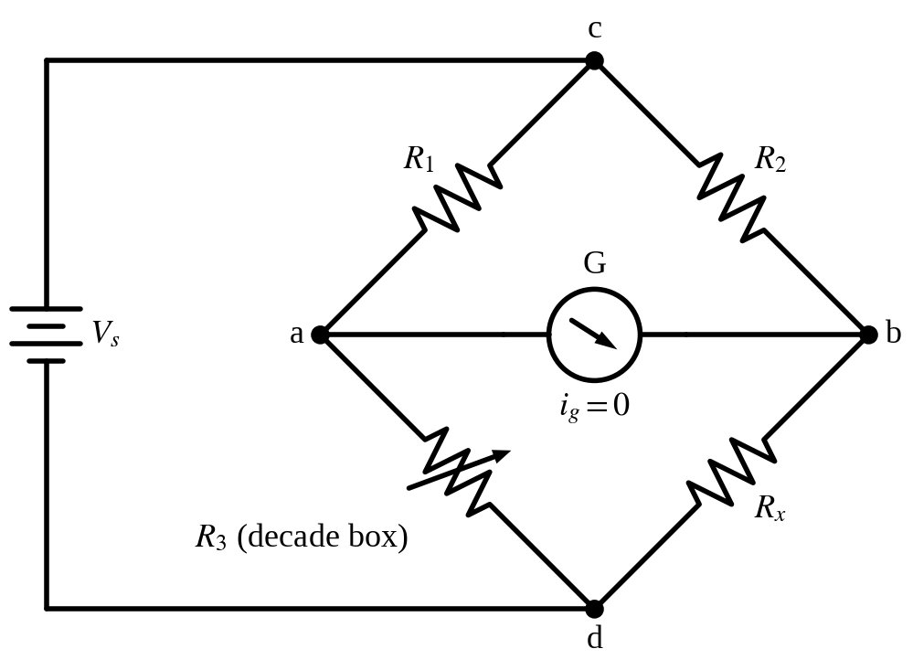
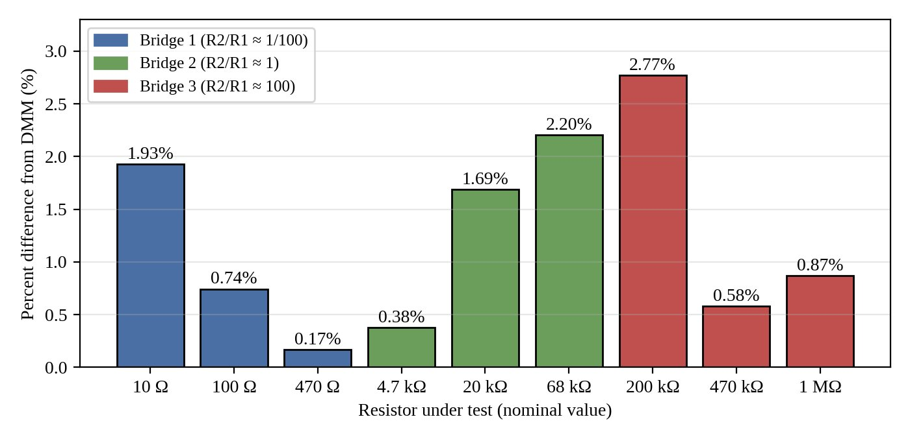

# Wheatstone Bridge: Measuring Resistance
**ECE 263 Linear Circuit Theory I · Lab 4 · Valparaiso University · Fall 2026**

> **Key result:** Every bridge estimate within 2.8% of the DMM; five of nine within 1%

Measured nine resistors across five decades by balancing a Wheatstone bridge instead of trusting a meter.

## What I did

- Built three bridges with 1/100, 1:1, and 100:1 ratio arms, a decade resistance box, and a galvanometer.
- Every estimate landed within 2.8% of the DMM reading, and five of nine within 1% (best: 0.17% on 470 Ω).
- Traced the error to contact resistance on the low-ratio bridge and decade-box resolution on the high-ratio bridge.

## Report
- 📄 [Full report (PDF)](Guerrero_ECE263_Lab4_Wheatstone_Bridge.pdf)

## Figures

### Schematic: Wheatstone bridge with galvanometer

### Chart: Bridge vs. DMM percent difference for all nine resistors

## Tools
Wheatstone bridge, decade resistance box, galvanometer, DMM

---

**Austin Guerrero** · Electrical Engineering, Valparaiso University (Christ Honors College)  
Portfolio: [austinguerrero.dev](https://austinguerrero.dev) · LinkedIn: [in/guerrero-austin](https://www.linkedin.com/in/guerrero-austin)
